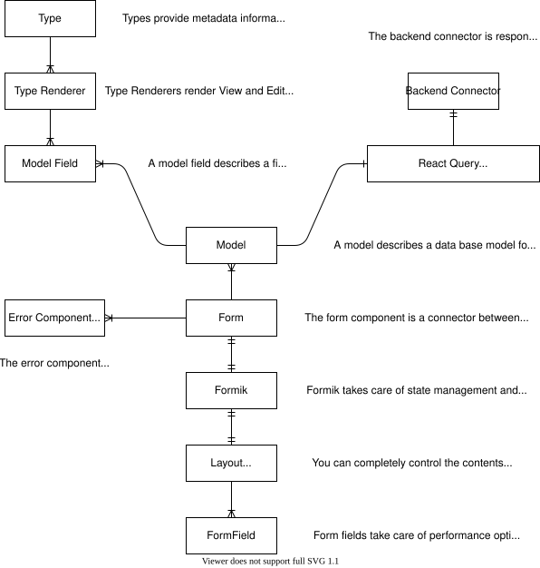

# Form Engine

## Purpose

The form engine enables you to create reusable form components and easily create large, very performant forms with built-in validations.

## Overview

<p align="center">
  
</p>

## Implementing in your application

The following will guide you though the required steps of implementing the form engine.

### Adding a backend connector

First we have to implement our own backend connector, for this we can use the following template code:

<details>
    <summary>TypeScript</summary>
    
```typescript
import {Connector, ModelFieldName, ResponseMeta, ModelGetResponse } from "components-care";

class BackendConnector<
  KeyT extends ModelFieldName,
  VisibilityT extends PageVisibility,
  CustomT
  > extends Connector<KeyT, VisibilityT, CustomT> {
    async index(
		params?: Partial<IDataGridLoadDataParameters>,
        model?: Model<KeyT, VisibilityT, CustomT>    
    ): Promise<[Record<KeyT, unknown>[], ResponseMeta]> {
        throw new Error("Not implemented");
    }

    async create(
        data: Record<string, unknown>,
        model?: Model<KeyT, VisibilityT, CustomT>
    ): Promise<Record<KeyT, unknown>> {
        throw new Error("Not implemented");
    }

    async read(
      id: string,
      model?: Model<KeyT, VisibilityT, CustomT>
    ): Promise<ModelGetResponse<KeyT>> {
        throw new Error("Not implemented");
    }

    async update(
        data: Record<ModelFieldName, unknown>,
        model?: Model<KeyT, VisibilityT, CustomT>
    ): Promise<Record<KeyT, unknown>> {
        throw new Error("Not implemented");
    }

    async delete(
      id: string,
      model?: Model<KeyT, VisibilityT, CustomT>
    ): Promise<void> {
        throw new Error("Not implemented");
    }
/* Only implement if your backend can handle multiple deletes in one request
	async deleteMultiple(
	  ids: string[],
	  model?: Model<KeyT, VisibilityT, CustomT>
    ): Promise<void> {
		return super.deleteMultiple(ids);
	}
*/
/* Only implement if your backend can handle delete all requests
	deleteAdvanced = async (
	  req: AdvancedDeleteRequest,
	  model?: Model<KeyT, VisibilityT, CustomT>
	) => {
        throw new Error("Not implemented");
    };
*/
/* Define if your backend supports data exporters
	dataGridExporters = undefined;
*/
}

export default BackendConnector;

````
</details>

<details>
    <summary>JavaScript</summary>

```javascript
import {Connector, ModelFieldName} from "components-care";

class BackendConnector extends Connector {
    async index(params, model) {
        throw new Error("Not implemented");
    }

    async create(data, model) {
        throw new Error("Not implemented");
    }

    async read(id, model) {
        throw new Error("Not implemented");
    }

    async update(data, model) {
        throw new Error("Not implemented");
    }

    async delete(id, model) {
        throw new Error("Not implemented");
    }
/* Only implement if your backend can handle multiple deletes in one request
	async deleteMultiple(ids, model) {
		return super.deleteMultiple(ids);
	}
*/
/* Only implement if your backend can handle delete all requests
	deleteAdvanced = async (req, model) => {
        throw new Error("Not implemented");
    };
*/
/* Define if your backend supports data exporters
	dataGridExporters = undefined;
*/
}

export default BackendConnector;
````

</details>

The documentation of the methods can be found in the superclass [Connector](../src/backend-integration/Connector/Connector.ts)

### Defining your models

Next up you have to define your data structures in a model. A minimalistic model looks like this:

<details>
	<summary>TypeScript/JavaScript</summary>
    
```typescript
import {Model, ModelDataTypeStringRendererMUI, ModelVisibilityDisabled, ModelVisibilityHidden} from "components-care";
import BackendConnector from "./BackendConnector";

const NameModel = new Model(
    "name-model-id",
    {
        id: {
            type: new ModelDataTypeStringRendererMUI(),
            visibility: {
                overview: ModelVisibilityDisabled,
                edit: ModelVisibilityHidden,
                create: ModelVisibilityDisabled,
            },
            getLabel: () => "ID",
            customData: null,
        },
    },
    new BackendConnector()
);

export default NameModel;

````


</details>

You need to define all additional fields required for your model yourself. A field definition looks like this:

<details>
	<summary>TypeScript diff</summary>

```diff
--- example.ts
+++ example-with-field.ts
@@ -14,6 +14,21 @@
             getLabel: () => "ID",
             customData: null,
         },
+        field_name: {
+            type: new ModelDataTypeStringRendererMUI(), // define your type & renderer here
+            visibility: { // modify to your liking
+                overview: ModelVisibilityDisabled,
+                edit: ModelVisibilityHidden,
+                create: ModelVisibilityDisabled,
+            },
+            getLabel: () => "Field name", // to use i18n: i18n.t.bind(null, "namespace:translation.key")
+            getDefaultValue: () => "Default value, do not define to set no default value", // supports async
+            validate: (value: string, values: Record<string, unknown>): string | null => {
+                if (value !== "valid") return "Value is not 'valid'!";
+                return null; // no validation errors
+            },
+            filterable: true, // optional, used for BackendDataGrid, defualts to false
+            sortable: true, // optional, used for BackendDataGrid, defualts to false
+            onChange: ( // optional on change hook
+                value: string,
+                model: Model<string, PageVisibility, null>,
+                setFieldValue: (field: string, value: unknown, shouldValidate?: boolean) => void
+            ): string => {
+                // you can modify the model itself in here, useful for e.g.: implementing conditional enums
+                return value;
+            },
+            getRelationModel: () => OtherModel, // required for backend connected data types. otherwise undefined
+            customData: null,
+        },
     },
     new BackendConnector()
 );
````

</details>

<details>
	<summary>JavaScript diff</summary>

```diff
--- example.js
+++ example-with-field.js
@@ -14,6 +14,21 @@
             getLabel: () => "ID",
             customData: null,
         },
+        field_name: {
+            type: new ModelDataTypeStringRendererMUI(), // define your type & renderer here
+            visibility: { // modify to your liking
+                overview: ModelVisibilityDisabled,
+                edit: ModelVisibilityHidden,
+                create: ModelVisibilityDisabled,
+            },
+            getLabel: () => "Field name", // to use i18n: i18n.t.bind(null, "namespace:translation.key")
+            getDefaultValue: () => "Default value, do not define to set no default value", // supports async
+            validate: (value, values) => {
+                if (value !== "valid") return "Value is not 'valid'!";
+                return null; // no validation errors
+            },
+            filterable: true, // optional, used for BackendDataGrid, defualts to false
+            sortable: true, // optional, used for BackendDataGrid, defualts to false
+            onChange: (value, model, setFieldValue) => { // optional on change hook
+                // you can modify the model itself in here, useful for e.g.: implementing conditional enums
+                return value;
+            },
+            getRelationModel: () => OtherModel, // required for backend connected data types. otherwise undefined
+            customData: null,
+        },
     },
     new BackendConnector()
 );
```

</details>

#### Required fields

A visibility with `required: true`, such as `ModelVisibilityEditRequired`, marks the field as
required with MUI's `required`: its label gets an asterisk and, on most controls, its input
is required. Like MUI's `required`, it doesn't validate. A required field without a
`validate` of its own can be saved empty. To refuse an empty value, give the field a
validator next to the visibility:

```typescript
title: {
    type: new ModelDataTypeStringRendererMUI(),
    visibility: {
        overview: ModelVisibilityGridView,
        edit: ModelVisibilityEditRequired,
        create: ModelVisibilityEditRequired,
    },
    getLabel: () => "Title",
    validate: validatePresence, // "The Title field is required"
    customData: null,
},
```

`validatePresence` refuses every falsy value, `0` and `false` included. A number or a switch
that may be `0` or `false` needs a validator of its own. A localized string field's value is an
object, which `validatePresence` always counts as present: use `validateLocalizedPresence`, which
refuses it while no language holds text, or `validateLocalizedPresenceFor(["en"])` to require
given languages. Without a validator, the asterisk
suits a field that may be saved incomplete, such as a draft that is checked when it is
submitted.

#### Defining your own Types and Renderers

Sometimes you need custom controls which aren't included in the default type library. In these cases you need to create your own Renderers or even Types.

Read more about implementing [your own renderers](../src/backend-integration/Model/Types/Renderers/README.md) and [your own types](../src/backend-integration/Model/Types/README.md) by following the respective link.

### Creating an error component

An error component will display the errors occurring in the form and the form components. It has a single property: `error`.
The `error` property is never null. Its `error` property may get updated from time to time.
Your component won't be unmounted until the form gets unmounted.

The error component is the _display_ channel only. Forwarding errors to an error tracker is a separate,
application-wide concern — see [Error reporting](#error-reporting) below.

A basic error component which uses dialogs can be found below:

<details>
	<summary>TypeScript</summary>
	
```tsx
import React, {useEffect} from "react";
import {ErrorDialog, ErrorComponentProps, useDialogContext} from "components-care"

const ErrorComponent = (props: ErrorComponentProps) => {
    const propError = props.error;

    const [pushDialog] = useDialogContext();

    useEffect(() => {
    	pushDialog(
    		<ErrorDialog
    			title={"An error occurred"}
    			message={propError.message}
    			buttons={[
    				{
    					text: "Okay",
    					autoFocus: true,
    				},
    			]}
    		/>
    	);
    	// eslint-disable-next-line react-hooks/exhaustive-deps
    }, [propError]);

    return <></>;

};

export default React.memo(ErrorComponent);

````

</details>


<details>
	<summary>JavaScript</summary>

```jsx
import React, {useEffect} from "react";
import {ErrorDialog, ErrorComponentProps, useDialogContext} from "components-care"

const ErrorComponent = (props) => {
	const propError = props.error;

	const [pushDialog] = useDialogContext();

	useEffect(() => {
		pushDialog(
			<ErrorDialog
				title={"An error occurred"}
				message={propError.message}
				buttons={[
					{
						text: "Okay",
						autoFocus: true,
					},
				]}
			/>
		);
		// eslint-disable-next-line react-hooks/exhaustive-deps
	}, [propError]);

	return <></>;
};

export default React.memo(ErrorComponent);
````

</details>

### Creating the form itself

To create a form you need two things:

- a model
- an error component

A form has two components: `Form` and `FormField`.
The `Form` component stores the form state and provides everything needed for validating and submitting the form.
The `FormField` component renders the field according to the model provided to the `Form` component.

A basic form looks like this:

<details>
	<summary>TypeScript/JavaScript</summary>

```tsx
<Form
	model={NameModel}
	id={null || "id"} // null for create new, "id" for edit existing
	errorComponent={ErrorComponent}
	renderConditionally
>
	{({ isSubmitting, values, submit }) => (
		<>
			<FormField name={"field-name"} />
			<Button
				disabled={isSubmitting}
				onClick={async () => {
					try {
						await submit();
						console.log("Submitted");
					} catch (e) {
						console.log("Validation errors:", e);
					}
				}}
			/>
		</>
	)}
</Form>
```

</details>

`submit` rejects when submitting fails, so that you can react to it. The error is displayed by your
error component either way, which means most call sites end up writing
`try { await submit(); } catch { /* ignore */ }`. Use `safeSubmit` instead of `submit` for those —
it's the same call with the rejection swallowed:

<details>
	<summary>TypeScript/JavaScript</summary>

```tsx
{({ isSubmitting, safeSubmit }) => (
	<>
		<FormField name={"field-name"} />
		<Button disabled={isSubmitting} onClick={() => void safeSubmit()} />
	</>
)}
```

</details>

`safeSubmit` is available on the render props, on `useFormContext()` and on `useFormContextLite()`.
It resolves to `false` if submitting failed and `true` otherwise, so you can still gate follow-up
actions on the outcome:

<details>
	<summary>TypeScript/JavaScript</summary>

```tsx
const onClick = useCallback(async () => {
	if (!(await safeSubmit())) return; // the error is already displayed and reported
	goSomewhereElse();
}, [safeSubmit, goSomewhereElse]);
```

</details>

Note that `true` does not mean the record was saved — `submit` is a no-op when the form isn't dirty
(unless you pass `ignoreDirtyCheck`) and when a `preSubmit` handler cancels submission, and both of
those resolve to `true`. Stick with `submit` when you need the error object itself. Prefer `submit`
in nested forms (`nestedFormName`) too: those don't render an error component of their own, and rely
on the error propagating to the parent form.

### Starting in a field

`FormField` takes `autoFocus` to put the cursor in the field a form should start in:

```tsx
<FormField name={"serial_number"} autoFocus />
```

It works like the `autoFocus` attribute: it applies when the field mounts. Turning it on for a
field that is already shown does not move the focus, and a control that replaces its input
later, such as a selector refreshing its options, does not take the focus back. Give it to one
field.

Every control with a keyboard input takes it: text and number fields, dates, selectors,
checkboxes, switches and enum selects. A radio group starts on the checked option, or on the
first one when none is checked. A control with several inputs focuses the one where typing
starts: the default language of a localized string, the empty entry at the end of a string array
(for a new value), the group selector of a multi select with tags. File and image uploads, the signature pad and the data grid multi select ignore
it.

A custom renderer receives it as `RenderParams.autoFocus`, see
[the renderer remarks](../src/backend-integration/Model/Types/Renderers/README.md#remarks). The
`Backend-Components/Form` story `AutoFocus` starts the form in any of its fields.

### Describing a field

A field's error or warning message is the description of its control: a screen reader reads it
when the user reaches the control, not only when the user happens to read on past it. While an
error shows, the control is marked invalid, checkboxes, radio groups and selects as well as text
fields. To describe a field with text of your own, such as instructions next to it, give the text
an id and pass it to `FormField`:

```tsx
<Typography id={"serial-hint"}>As printed on the type plate</Typography>
<FormField name={"serial_number"} aria-describedby={"serial-hint"} />
```

The control is then described by your text, followed by the message while one shows. `id` sets the
id of the field's control, for a link or a label of your own that points to it; by default each
`FormField` generates one. The message gets the id `<id>-message`.

A file upload is a group of controls in a frame: the frame gets the id and the description, so a
screen reader reads the message when focus enters the field.

Selectors are marked invalid, but not described by the message yet. Date and time fields,
localized strings, image uploads, the tag selector and the data grid multi select take neither
the id nor the description yet.

A custom renderer receives the ids as `RenderParams.id`, `messageId` and `describedBy`, see
[the renderer remarks](../src/backend-integration/Model/Types/Renderers/README.md#remarks).

### Showing dirty state

A field can be marked as modified with a small blue dot after its label. Nothing is marked
unless you ask for it, and what counts as modified is the application's decision, not the
form engine's.

The form engine's own answer is a diff against the server value, not a "has been edited"
latch: restoring the original value clears the marker, and a value set programmatically is
modified without the user ever having focused the field. It is independent of `touched`.
Switch it on with `showDirtyState`:

```tsx
<Form model={model} id={id} showDirtyState>
	{FormContent}
</Form>
```

The dot is deliberately not an asterisk (that means required) and not a tint of the input
(yellow is a warning, red an error, blue the focus ring) — it sits beside the label so it
stacks with all three.

The dot is for the eye. For a screen reader the label also ends in a visually hidden
"(modified)" in the user's language (`DirtyMarkerText`, translation key
`standalone.uikit.field-state.dirty`), which makes it part of the field's name: a modified
"Due" field is read as "Due (modified)". It takes no room, so nothing moves on screen.
`withMuiFieldState` adds it to the label of the control it wraps, and `DirtyMarker` renders
it after its dot. A label rendered as a child of `FormControlCC` or
`FormControlFieldsetCC` — a legend, a `FormControlLabel` — gets its dot from the wrapper
but not the text: render it as `labelWithDirtyText(label, dirty)`, as the library's
checkbox, switch, radio and select renderers do.

#### Marking fields yourself

Where the application knows better than the diff does, wrap the fields in a
`DirtyStateProvider`. It takes the marks outright, or a function which is handed the form
engine's own per-field state to build on. A change request workflow is the case this
exists for: the proposed record is saved, so the form is not dirty, and the fields the
proposal touches still have to stand out.

<details>
	<summary>TypeScript</summary>

```tsx
const marks = useCallback(
	(formDirtyFields: DirtyStateMarks) =>
		Object.fromEntries(
			Object.keys(formDirtyFields).map((field) => [
				field,
				formDirtyFields[field] ||
					baselineRecord[field] !== proposedRecord[field],
			]),
		),
	[baselineRecord, proposedRecord],
);

<DirtyStateProvider marks={marks}>{fields}</DirtyStateProvider>;
```

</details>

Memoize `marks`, or declare the function outside the render: a new value re-renders every
field below it.

A provider overrides `showDirtyState` for its subtree, and `Form` always sets the marks —
to its own per-field state with `showDirtyState`, and to none without — so a nested form
never inherits the marks of the form around it.

#### Reading the state

- `RenderParams.dirty` — handed to the type renderer, and forwarded by every renderer in
  the library to its control as a `dirty` prop, the same way `warning` is. This is the
  resolved display state, whatever produced it.
- `useDirtyState(field)` — the same flag, for a custom (non-model) field: reading it makes
  the field follow the same switch as the model fields. `useDirtyState()` returns the whole
  map.
- `useFormContext().dirtyFields` — what the form engine computed, one entry per model
  field, regardless of what is displayed. Custom fields are not in there: a custom field is
  the thing calling `setCustomFieldDirty`, so it already holds its own dirty state; what
  the form does with it is fold it into the form-wide `dirty` flag. In a flow form, changes
  set `"staged"` (a nested form whose stage was left) go into `stagedDirty` instead.
- `showDirtyState` on both the full and the lite form context — was the form asked to mark
  its modified fields? This is the form-wide switch, for a control which holds dirty state
  of its own and wants to display it on the same terms as the model fields. Whether a given
  *field* is marked is `useDirtyState`'s question, and a `DirtyStateProvider` can answer it
  differently.

#### Marking tabs

`RoutedTabs` renders only the panel of the open tab, so the fields of the other tabs show
nothing: neither their marker nor their error. `FormTab`, a MUI `Tab` with the fields of
its panel listed, shows both on the tab's label: the modified marker while one of its
fields is marked (the same marks as the fields, so it follows `showDirtyState` and a
`DirtyStateProvider`), and an error icon while one of its fields shows a validation error
(touched and invalid, as `FormField` shows it; a save touches every field, so after a save
that failed validation every tab holding an invalid field is marked). The tab's accessible
description says the same in words.

<details>
	<summary>TypeScript</summary>

```tsx
const CONDITION_FIELDS = ["price", "discount", "payment_terms"];

<RoutedTabs aria-label={t("tabs.label")}>
	<FormTab value="" label={t("tabs.contract")} fields={CONTRACT_FIELDS} />
	<FormTab value="conditions" label={t("tabs.conditions")} fields={CONDITION_FIELDS} />
</RoutedTabs>;
```

</details>

`dirty` and `error` mark a tab regardless of its fields, for a custom field or a form that
computes its own marks; they also work outside a Form. Every other prop goes to MUI's
`Tab`, so `FormTab` works in a state-driven MUI `Tabs` as well. On a coloured tab bar
(`textColor="inherit"`, e.g. in an `AppBar`) both markers take the tab's text colour.
The `Backend-Components/Form/FormTab` stories show it in a routed form and every
combination of the markers.

#### Restyling the marker

Two theme slots, depending on which half you want. `CcFieldState` is shared by every
control wrapped in `withMuiFieldState` — which is where the label pseudo element lives, the
selectors' own label included — and `CcDirtyMarker` styles the element version, rendered by
the three controls whose label the pseudo element can't reach: `FileUploadGeneric` and
`ImageSelector` (fieldset legend) and `MultiSelectWithTags` (a `Typography` title):

<details>
	<summary>TypeScript</summary>

```ts
createTheme({
	components: {
		// recolour the element version
		CcDirtyMarker: { styleOverrides: { root: { backgroundColor: "#7b1fa2" } } },
		// italic label instead of a dot, everywhere else
		CcFieldState: {
			styleOverrides: {
				root: {
					"& > .MuiFormLabel-root::after": { display: "none" },
					"& > .MuiFormLabel-root": { fontStyle: "italic" },
				},
			},
		},
	},
});
```

</details>

One thing to know if you replace the dot with something wider: an outlined input sizes the
gap in its border from a second copy of the label that a pseudo element cannot reach, so
the stock styles widen that gap by the width of the dot. A wider marker has to widen it
further, through
`& > .MuiOutlinedInput-root .MuiOutlinedInput-notchedOutline legend > span:not(.notranslate)`
— the `:not` matters: MUI renders that legend whether or not the input holds a label, and
widening the empty one puts a gap in the border of every control which labels itself
outside the input, as the selectors do.

A text field's label keeps room for the dot at its own end as well. MUI cuts a label too
long for the field with an ellipsis, so the dot is placed in that room rather than after
the text, and the ellipsis comes before it. The room is the `padding-inline-end` of
`& > .MuiInputLabel-formControl`: a wider marker widens it, a theme that drops the dot can
set it to 0.

For a custom renderer, `DirtyMarker` (an element) and `dirtyMarkerStyles` (for a pseudo
element) are both exported, so a control can draw the same marker wherever its label is.
`DirtyMarker` brings the hidden text along; with `dirtyMarkerStyles` add
`DirtyMarkerText` to the label yourself.

The hidden text is the `text` slot of `CcDirtyMarker`, wherever it is rendered. Removing
the dot leaves it in place, which keeps the state in the field's name;
`CcDirtyMarker: { styleOverrides: { text: { display: "none" } } }` removes it too.

A `FormTab`'s dot is the `CcDirtyMarker` element too, so restyling that one restyles the
tab's. Its own parts are styled under `CcFormTab`: `label` (the label with its markers),
`dirtyMarker` and `errorIcon`.

The `Backend-Components/Form` stories show all three modes: `DirtyState` marks the form's
own diff across a text field, an outlined multiline one, a searchable select, a date, an
image selector, a radio group, a checkbox and a switch; `DirtyStateHidden` is the default;
`DirtyStateProvided` supplies its own marks.

### Collections that belong to the record

Files, images and other records that belong to the form's record but live at an endpoint of
their own (`records/42/attachments`) are edited by controls that write to that endpoint
themselves: `FormCrudFileUpload`, `FormCrudMultiImage` and `FormCrudMultiSelect`. They are
custom fields, not fields of the model.

```tsx
<FormCrudFileUpload
	field={"attachments"}
	initialId={id}
	getEndpoint={(id) => `v1/records/${id}/attachments`}
	serialize={serializeAttachment}
	deserialize={deserializeAttachment}
	label={t("attachments")}
/>
```

Each builds a `LazyConnector` with `useLazyCrudConnector`, from `field`, `initialId`,
`getEndpoint` and the hook's other params. Reads go to the endpoint, writes are queued, and the
queue is sent after the form saved the record, so a new record gets its files too. While
anything is queued the form is dirty. The connector is kept as the form's custom state of
`field` (`useFormContext<M>().getCustomState<LazyConnector>(field)`). `field` names the control
in the form and has to be unique there: two controls with one `field` mix up their
collections, and the save sends the queue of only one of them.

They take the form's `readOnly` on top of their own, and its `errorComponent`.
`FormCrudMultiSelect` is read-only in a read-only form, not disabled: it shows its label and
the entries, without search field, end adornments or remove buttons ("No entries" when there
are none), as `FormCrudFileUpload` drops its upload button. A save makes the form read-only as
well, but leaves the field as it is, with its focus and the text typed into it; only picks
and removals are ignored while it runs.
While `FormCrudMultiSelect` is read-only, disabled or saving, nothing else writes to it either:
its ref's `addToSelection` rejects, and the select context's `handleSelect`, which end
adornments call, ignores the change. An end adornment reads
`useCrudSelectContext().disabled` to lock its own buttons.
`FormCrudFileUpload` and `FormCrudMultiSelect` also follow the form's `showDirtyState` unless
their own prop is set.
Outside a form, use `CrudFileUpload` and `CrudMultiImage` with a connector of your own: they
do not read the form. `useLazyCrudConnector` and the `FormCrud…` controls throw outside a form.
A component of your own that works in and outside forms reads `useContext(FormContext)` and
renders a child that calls `useLazyCrudConnector` only inside a form; catching the error
instead makes the hook call conditional, against the rules of hooks.

Things to know about the queue:

- `FormCrudFileUpload` marks a queued upload as added and a queued removal as struck through,
  with a restore. `FormCrudMultiSelect` marks a queued pick "Added" and lists a queued
  removal after the selected entries, struck through and marked "Removed", with a restore
  button where its remove button was; it finds an entry's queued write by the entry's
  `value`, the record's id. `CrudMultiSelectWithGroups` given a `LazyConnector` (from
  `useLazyCrudConnector`) marks its chips the same way, and takes `showDirtyState` itself; a
  group pick restores a removed entry of the group. `FormCrudMultiImage` shows queued changes
  as if they were saved: there are no marks, no restore and no dirty marker.
- A write of the queue that the backend refuses does not stop the save: the creates and
  updates queued after it are sent. The refused one stays queued, marked as not saved yet
  where the control marks changes, so the form stays dirty. The deletes queued after a
  refused write stay queued until it went through, as a delete may be the second half of a
  replacement (`FormCrudFileUpload` uploads a file again under its name, then deletes the
  old one). The submit rejects although the record was saved, and the form's error component shows which
  writes were refused: `FormCrudMultiSelect` names each by its entry's label ("Frank Wilson:
  Person 6 is archived", several joined with "; "), `FormCrudFileUpload` and
  `FormCrudMultiImage` by its file's or image's name ("Could not upload bad.txt: File too
  large.", one sentence each), as they do for a refused write through any other connector.
  A refused delete is dropped, as the record may be gone already.
- An entry created through the queue has a client-side id (`fake-id-N`) as long as the form
  edits the record. It keeps it in `onChange`, and in the multi image's `onPrimaryChange`, also
  after the save; `LazyConnector.mapId` gives the server's id once the queue is sent.
- `deserialize` gets a queued entry as `serialize` returned it, with that client-side id as
  `id`: a picked file where the backend would send a URL. After the save the connector still
  lists the created record under that id. So derive nothing but the entry's own id from `id`
  (the `value` of a `FormCrudMultiSelect` entry), and read other ids, such as the picked
  record's, from a field `serialize` returns.
- A `FormCrudMultiSelect` pick has the value `"to-create-<getIdOfData>"` until it is created:
  `serialize` leaves it out of what the create sends. An end adornment that adds entries
  builds them with the select context's `modelToSelectorData` (`useCrudSelectContext()`).
- `onQueueSent(id, connector)` runs on every save once the queue was sent, with the saved
  record's id, before the form's `onSubmit`. The save waits for it, and a rejection fails the
  submit. It is not called while the backend refuses a write of the queue. Use it for what has
  to wait for the server's ids, e.g. storing a new primary image with the record, which was
  saved before the queue:
  `onQueueSent={(id, connector) => savePrimary(id, connector.mapId(primaryId))}`.
- `onParentIdChange` gets the parent record's id before the queue is sent: on every save, and
  for an existing record once the control mounted. A new record has no id before its save:
  `getEndpoint` gets the string `"null"` to build the connector, but the list is never
  requested from that endpoint.
- A control that unmounts keeps its queue, and lists it again when it mounts again. Without
  `onlySubmitMounted` the next save sends it. With `onlySubmitMounted` the queue of an
  unmounted control is neither saved nor counted as dirty, like the value of an unmounted
  field, until the control mounts again. A page that hides a control when the record no
  longer needs its collection gives the form `onlySubmitMounted`, or the save sends the
  hidden control's changes anyway. What counts is the `onlySubmitMounted` the form has when the
  control unmounts: while the control is mounted its queue keeps the form dirty and is saved,
  also when `onlySubmitMounted` changes meanwhile (the form's prop, or the config of a flow
  stage).
- In a flow form, a submit (`goToStage` makes one before it changes the stage) stages the queue
  of every mounted control, like the values of the mounted fields, until the queue is empty
  again. A control that unmounts with a staged queue, as it does when its stage is left, keeps
  the form dirty, and the next submit to the server sends the queue with the record. A control
  hidden within its stage, with nothing staged since it mounted, follows `onlySubmitMounted`.

The `Backend-Components/FileUpload` stories `InForm` and `InReadOnlyForm` show both file
controls in a form.

### Error reporting

Independently of what your error component displays, Components-Care forwards unexpected errors to an
error tracker. If `@sentry/react` is installed it is used automatically, otherwise nothing happens.
By default a `ValidationError` and a `NetworkError` are **not** reported (neither is actionable —
one is a normal part of the form flow, the other is usually the user's connection), while a
`BackendError` and code errors (`Error`, `TypeError`, ...) are. A `PartialApplyError` is judged by
the errors it wraps (see below).

Both the policy and the destination are configurable from your application's startup code:

<details>
	<summary>TypeScript/JavaScript</summary>

```ts
import { configureErrorReporting, CcErrorNames } from "components-care";

configureErrorReporting({
	// where reported errors go (default: Sentry's captureException, if available)
	report: (error, context) => myTracker.capture(error, context.source),
	// which errors get reported
	shouldReport: (error) => error.name !== CcErrorNames.NetworkError,
	// additionally console.error everything, regardless of shouldReport (default: false)
	logToConsole: import.meta.env.DEV,
});
```

</details>

Errors are matched by `Error.name`, not by `instanceof`, because the error classes may cross bundle
boundaries. `CcErrorNames` holds the names of every error class the library raises:

| Constant                            | `Error.name`           | Reported by default       |
| ----------------------------------- | ---------------------- | ------------------------- |
| `CcErrorNames.ValidationError`      | `CcValidationError`    | no                        |
| `CcErrorNames.NetworkError`         | `NetworkError`         | no                        |
| `CcErrorNames.BackendError`         | `BackendError`         | yes                       |
| `CcErrorNames.RequestBatchingError` | `RequestBatchingError` | yes                       |
| `CcErrorNames.ImageLoadError`       | `CcImageLoadError`     | yes                       |
| `CcErrorNames.PartialApplyError`    | `CcPartialApplyError`  | if one of its failures is |

An `ImageLoadError` is raised when the browser can't decode an image the user selected — an
unsupported format (HEIC, TIFF) or a corrupt file. The user is always shown a message for it, so if
you don't want these in your error tracker, filter the name out via `shouldReport`.

A `PartialApplyError` lists the writes of a CRUD control's change that did not go through, each
with its error (`failures[].error`). A Form's save rejects with it when the backend refused writes
of a lazy control's queue (see above), and the form reports it. The default policy reports it if
at least one of those errors would be reported on its own (a `BackendError`, a code error), and
not if none would: when all of them are `NetworkError`s because the connection dropped while the
queue was sent, or names in the call site's `ignoreNames`. A failure whose error is no `Error`
counts as reported. A custom `shouldReport` gets the `PartialApplyError` itself; read its
`failures` to filter by the errors inside, or hand it to `defaultShouldReportError`.
